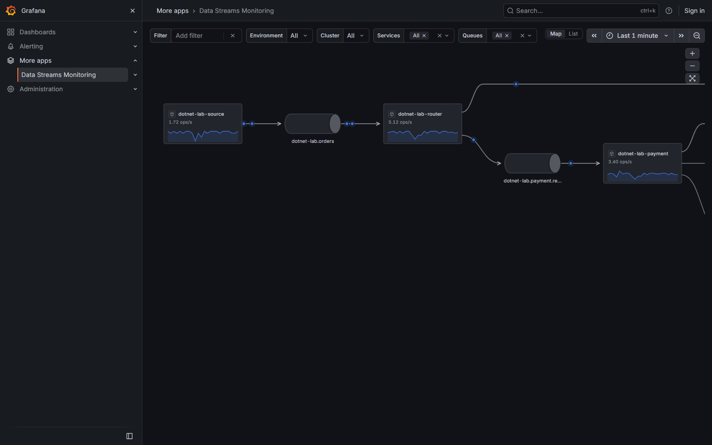
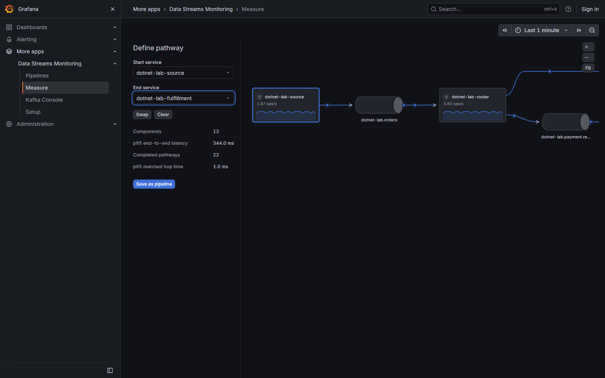

# Data Streams Monitoring for Grafana

Explore Kafka producer → topic → consumer relationships from standard OpenTelemetry traces. Native Grafana controls, tables and charts surround an interactive topology with observed-flow animation and causal pathway timing. .NET and Confluent.Kafka are the first integration focus.



The map supports native variable filters and time ranges, pointer/touch pan, cursor-anchored zoom and reduced motion. List, Pipelines, Measure, Kafka Console and Setup are linked through Grafana's sidebar. These screenshots show this app's own local Kafka lab, not a traffic-coverage or performance guarantee.



## Projects

| Project | Responsibility |
| --- | --- |
| [Grafana app](kolbyd-datastreamsmonitoring-app/README.md) | React frontend, Go Grafana Live bridge, nested snapshot data source, local provisioning and browser checks. |
| [Flow collector](live-flow/README.md) | ASP.NET Core OTLP/HTTP trace ingestion, bounded topology/causal aggregation and authenticated streaming. |
| [.NET instrumentation](live-flow-dotnet/README.md) | Explicit Confluent.Kafka helpers using ActivitySource, Meter and W3C propagation; applications configure their OTel SDK/exporters. |
| [Real Kafka lab](dotnet-kafka-lab/README.md) | Isolated local Kafka with ten .NET workers, fan-out/fan-in, cross-trace joins, retries and dead-letter routes. |

```text
Kafka applications → standard OTLP traces → Flow collector
  → Go plugin bridge → Grafana Live → app
  → Go snapshot proxy → Data Streams data source
```

The collector is a separate required process for this app. It does not require Kafka credentials; it derives the graph from telemetry. Keep an existing OTel pipeline and add a collector fan-out branch where appropriate.

The catalog app ID is `eageraspen2909-datastreamsmonitoring-app`; the nested data-source ID is `eageraspen2909-datastreamsmonitoring-datasource`. The physical app folder retains its original scaffold name.

## Try locally

Install Docker Desktop with Linux containers, Node.js 24.15 or newer, Go and Mage. The local browser launcher uses Microsoft Edge. From the repository root in PowerShell:

```powershell
cd kolbyd-datastreamsmonitoring-app
./build-review.ps1
./start-review.ps1
```

Open [Map](http://127.0.0.1:3001/a/eageraspen2909-datastreamsmonitoring-app/explore). **Setup** offers an explicitly labeled synthetic example; it does not connect to Kafka. Follow the [lab README](dotnet-kafka-lab/README.md) for actual Kafka traffic.

The launcher provisions isolated local Grafana and collector containers on loopback ports 3001 and 4318, using random Docker secrets. Anonymous access is Viewer only; connection changes require an administrator. Stop only this review project with `./start-review.ps1 -Stop`.

See [contribution setup and test commands](CONTRIBUTING.md) for all four projects and [configuration/local review](kolbyd-datastreamsmonitoring-app/docs/build-review.md) for authentication and deployment details.

## Measurement boundaries

- Rates are **observed operations**, affected by sampling, batches, missing instrumentation, retention and stream limits. They are not authoritative broker message counts or complete traffic coverage.
- Complete retained send/process parent/link chains can establish an observed range from first retained send to terminal processing completion. A graph path or receive span alone is not business completion. Batch ranges are not individual-message latencies.
- Broker lag, broker health, partitions and rebalances are not collected. The collector has no OTLP metrics receiver; library metrics need a standard metrics backend.
- Collector history is bounded and in memory. Historical selection cannot recover discarded data; partial coverage is reported.
- Pipeline definitions are browser-local. No prebuilt dashboards, rendered Saved Views, CLR profiler or automatic Kafka interception are included.
- The Kafka lab has volatile joins and application-owned delivery policies; it does not establish exactly-once processing or a durable outbox.

Recorded local evidence is in [plugin validation](kolbyd-datastreamsmonitoring-app/docs/review-results.md) and [Kafka lab validation](dotnet-kafka-lab/VALIDATION.md). A passing local workload is not a production capacity or availability claim.

## Releases and development

The initial [v1.0.0 release](https://github.com/kolbyd/grafana-data-streams-monitoring/releases/tag/v1.0.0), its catalog submission and its release archives are frozen. Subsequent main-branch CI/documentation work is tracked under [Unreleased](CHANGELOG.md); it does not replace those artifacts.

The initial plugin archive targets Linux AMD64 and is unsigned for first catalog review. Catalog approval and public signing are separate. Grafana's backend needs network access to the collector; Grafana Cloud cannot reach a workstation's loopback address. No Cloud installation is performed by the local launcher.

Read [CONTRIBUTING.md](CONTRIBUTING.md) before changing code. The root [CI workflow](.github/workflows/ci.yml) targets Node 24.15.0, Go 1.27.3 and Grafana 13.2.4/13.3.0 browser coverage. Its actual runs determine status; the recorded 1.0.0 local results do not assert that new main-branch CI has passed. The [release workflow](.github/workflows/release.yml) is for future checked draft releases and does not replace v1.0.0.

## License

[Apache-2.0](LICENSE). Runtime third-party notices accompany the plugin package and the projects that require them.
