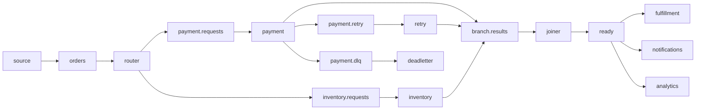

# .NET Kafka fan-out / fan-in lab

A real, local .NET 8 workload using Confluent.Kafka and the sibling [OpenTelemetry-first LiveFlow.Kafka library](../live-flow-dotnet/README.md). It includes a runnable demo, an xUnit test project and a real-Kafka smoke test. Ten child worker processes have distinct `dotnet-lab-*` service resources and one tracing provider/exporter each, so the topology shows actual service boundaries without multiplying exports.



Topics have the `dotnet-lab.` prefix. The three `ready` consumers use different Kafka groups, so **each** gets every ready order. The router publishes payment/inventory requests concurrently under one process span. Payment and inventory publish to a shared results topic; the join waits for one result of each type for the same deterministic order ID.

Inventory runs under an independent background-job trace linked to its incoming producer. The join creates a **new root Consumer process span with two actual ActivityLinks**, preserving payment and inventory contexts across different traces. Its ready send is a child of that join. It never fabricates a shared trace ID or pretends that either input alone caused the output. The single results topic makes the batch destination truthful.

## Start the demo

Prerequisites: .NET SDK 10, .NET 8 runtime, Docker Desktop running Linux containers, and the local image `confluentinc/cp-kafka:8.4.0`. Keep this folder beside `live-flow-dotnet`; the workload references that existing library project.

From this directory:

```powershell
dotnet restore DotNetKafkaLab.slnx --locked-mode
dotnet build DotNetKafkaLab.slnx -c Release --no-restore

# Start the isolated Kafka and run for three minutes, at one order/second:
.\Start-Lab.ps1 -DurationSeconds 180 -Rate 1

# Or run hidden in the background while using Grafana:
.\Start-Lab.ps1 -Background -DurationSeconds 300 -Rate 1
```

The scripts target only Compose project **`dsm-dotnet-lab`**. Kafka is bound only to **`127.0.0.1:19092`**; controller/internal listeners are not published. This is a one-broker KRaft development cluster. The application verifies its expected cluster ID before creating topics and cannot accept a different bootstrap address. Existing Kafka clusters are not used.

The start script defaults to standard OTLP HTTP/protobuf on `http://127.0.0.1:4318` when no endpoint is already configured. Set normal `OTEL_EXPORTER_OTLP_*` environment configuration for the local Collector/flow service before starting. If authentication is needed, the normal OTLP header environment variable is inherited by child processes in memory. No script accepts, reads back, prints or saves credentials. There is no `.env` or credential file.

Only traces are exported by default, because the local flow service may be trace-only. Use `-ExportMetrics` only when the configured standard metrics endpoint supports OTLP metrics. `-NoExport` runs Kafka and the local telemetry audit without contacting a Collector. After Kafka/build are ready, `-SkipKafka -SkipBuild` avoids repeating setup.

The normal library mode is used throughout: W3C `traceparent`/`tracestate`/baggage; no private pathway header, checkpoint sink or schema. Retry/DLQ routes are visible through real business topics, without requiring custom telemetry attributes.

## Stop and clean up

```powershell
.\Stop-Lab.ps1                 # Signal the orchestrator/workers; retain Kafka and its data.
.\Stop-Lab.ps1 -StopKafka      # Also stop only this lab's Compose project; retain its volume.
.\Stop-Lab.ps1 -ResetData      # Explicitly remove only this lab's Kafka volume/data.
```

Foreground Ctrl+C also requests shutdown. Runs have bounded durations; workers dispose clients/providers and flush telemetry. The orchestrator starts consumers first, waits for Kafka partition assignments, then starts the source. A finite `-Count` run waits for expected destinations, within its duration limit. An interrupted/timed continuous run can leave records in Kafka; stopping does not claim that all business work drained.

Background status and nonsecret counters/logs live under `.lab-state/`. A stop-file signal avoids killing arbitrary processes by PID. Start refuses a still-active prior process; use Stop first. Use a fresh run ID for another run. IDs are deterministic within a run (`run-order-000001`, etc.); business payloads/keys are not exported as metric dimensions.

## Run tests

```powershell
# Formal xUnit tests; no Kafka or Collector required:
dotnet test DotNetKafkaLab.slnx -c Release

# Real isolated Kafka, plus the unit suite and a finite integration smoke:
.\Test-Lab.ps1

# Kafka/build already available:
.\Test-Lab.ps1 -SkipKafka -SkipBuild
```

The smoke sends 24 orders at six/second with export disabled and asserts:

- Router fan-out delivers both branch requests for every order.
- Every seventh payment retries once; every eleventh goes to DLQ instead, with permanent failure taking precedence.
- 22 orders join successfully, with two different producer trace IDs and two retained links on every new-root join span.
- Fulfillment, notifications and analytics each observe all 22 ready orders.
- Three retry records and two DLQ records reach their real Kafka consumers.
- Every observed message has standard W3C propagation, with no proprietary header.
- Real receive spans measure the actual `Consumer.Consume` calls separately from processing.

Each real poll is timed before calling `Consume`. For a returned current-run record, its receive span gets the actual topic/group/partition/offset and a producer link, then closes **before** the handler/join. Timeout/old-run polls carry no Kafka observation attributes, so they are not fake messages. Processing remains its own truthful completion boundary. Idle poll Activities can still be present in an unfiltered trace backend.

The xUnit tests cover cross-trace join identity, repeated inputs, mismatched orders, expiry/capacity, deterministic retry/DLQ routing and argument/path bounds. [Validation results](VALIDATION.md) record the actual local run.

## Workload and correctness limits

This is an intentionally small lab, not a durable processing engine. The join buffer is bounded to 10,000 pending orders with a 60-second TTL. It is volatile. Joiner input offsets remain uncommitted so restart/replay is visible rather than falsely asserting durable state; restart can duplicate ready events. DLQ orders have no payment result and their unmatched inventory result expires. Other consumers commit after their handler completes. Producing output and committing input are not an atomic transaction, so retries/restarts can duplicate outputs. Producer idempotence does not establish application exactly-once delivery.

There is no database, durable outbox, authoritative broker-lag exporter or CLR profiler. The library emits ordinary standard telemetry; the demo owns its clients, receive instrumentation and business handlers. Join spans are batch-operation samples, not per-input-to-output latency allocations. Payload order IDs correlate business results only; causal trace evidence comes from real parents/links.

Useful entry points:

- [Workload.cs](src/DotNetKafkaLab/Workload.cs): router, branch handling, actual receive polls and two-input join.
- [Program.cs](src/DotNetKafkaLab/Program.cs): child process orchestration/readiness/shutdown/smoke assertions.
- [Telemetry.cs](src/DotNetKafkaLab/Telemetry.cs): per-service OTel provider and local span audit.
- [WorkflowTests.cs](tests/DotNetKafkaLab.Tests/WorkflowTests.cs): formal test project.

Current official API guidance was checked through Context7: [Confluent .NET client](https://github.com/confluentinc/confluent-kafka-dotnet), [Confluent KRaft Docker configuration](https://docs.confluent.io/platform/current/installation/docker/config-reference.html), [OpenTelemetry .NET Activities/links](https://github.com/open-telemetry/opentelemetry-dotnet/blob/main/src/OpenTelemetry.Api/README.md), and [Kafka semantic conventions](https://github.com/open-telemetry/semantic-conventions/blob/main/docs/messaging/kafka.md).
