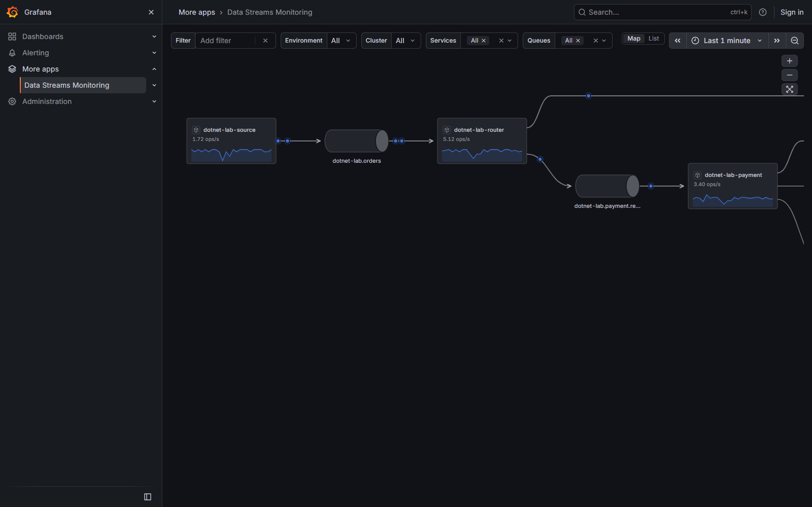
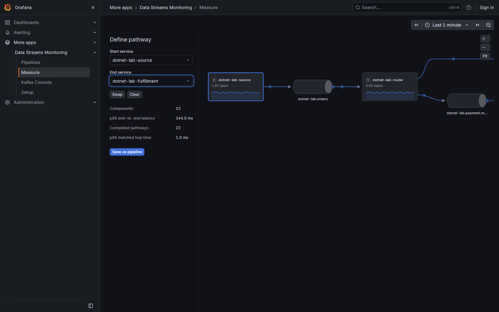

# Data Streams Monitoring

Inspect Kafka producer → topic → consumer relationships and causal operation ranges from standard OpenTelemetry traces, with .NET prioritized. Native Grafana controls/tables/Scenes charts surround a custom live topology. Grafana's sidebar is the only top-level navigation; every page uses a dashboard-style canvas.

Screenshots capture this app's own local Kafka lab; they are not traffic-coverage or performance guarantees.

## Connect

Enable the app, open Configuration, enter the separate flow collector's server-side HTTP(S) address and optional API key, then Save and test. Credentials remain in Grafana secure settings. A Go backend bridges collector snapshots/WebSocket data into Grafana Live; this app is not backend-free.

## Map and List

The single compact native row provides Filter, Environment, Cluster and Services/Queues multiselect pills (All by default), Map/List and the normal Grafana TimeRangePicker with relative/absolute ranges and timezone selection.

The map fills remaining space. Drag with pointer/touch to pan; wheel zoom anchors at the cursor. Native zoom/Fit controls use scale 0.25–3. Organized arrows/curves and hover/focus native tooltips show direction, observed ops/s and errors. Blue/error particles traverse observations over 1.8 seconds. Reduced motion is automatic.

List shows sortable Services/Queues tables and column selection, with Operations in/out in ops/s. Setup labels its service rates Observed ops/s. The chosen interval removes inactive edges and orphan nodes, including worker/group relationships, and limits selector options to active entities. Relative live ranges also use last-arrival edge activity; historical ranges depend on retained events/process completions.

There is no in-page app title, duplicate primary page tabs, saved-view UI, Services/Queues drawer, Pause button, Updated label or Map Preview shortcut. Example data can be activated only in Setup and remains clearly labeled.

## Other pages

Pipelines stores personal browser-local start/end definitions with create/edit/remove and Definition/Summary/Components/Monitors sections. Native charts show rates, matched hops and complete causal ranges. Measure chooses/swaps endpoints and saves a pipeline. Monitor creation is not implemented.

Kafka Console shows observed clusters/topics/groups with native tables/charts. Setup lists discovered services, collection guidance and configuration. No prebuilt dashboards or dashboard links are bundled. The Data Streams data source remains available through the configured backend.

## Measurement boundaries

The backend frame budget is 3 MiB for Grafana Live's 4 MiB outbound queue; partial coverage remains reported. Counts are observed operations, not authoritative message counts or full sampled-trace traffic. Historical data is bounded and in memory. Broker health/lag are uncollected; this collector has no OTLP metrics receiver.

Complete standard send/process chains with parent/link context and cross-trace joins support first-retained-send to terminal-processing ranges. Missing/conflicting/failed/clock-skewed evidence suppresses complete values. Batch pathways measure operation ranges, not individual-message latency. Optional dsm.* enrichment does not require a private protocol.

The separate .NET library defaults to standard ActivitySource/Meter/W3C propagation with explicit application integration. Custom pathway/checkpoint extensions are opt-in, and their separate checkpoint schema is not ingested here. The isolated .NET Kafka lab supplies actual fan-out/fan-in and linked joins; local validation does not establish Cloud or production readiness.

## Deployment

Requires Grafana 13.2.4 or newer and the separately running collector. The backend package targets Linux AMD64. App ID: eageraspen2909-datastreamsmonitoring-app; data-source ID: eageraspen2909-datastreamsmonitoring-datasource. Catalog publisher account: kolbyd1; organization: eageraspen2909. Signing and a supported distribution route remain required for installation beyond the isolated development setup.

[Source repository](https://github.com/kolbyd/grafana-data-streams-monitoring) · [Report an issue](https://github.com/kolbyd/grafana-data-streams-monitoring/issues). Repository creation does not imply a release or Grafana catalog approval.
